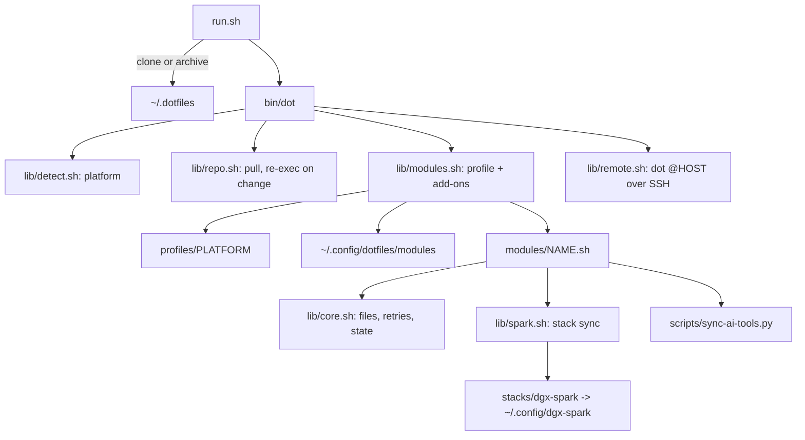

# Architecture

Use this guide when you change the installer, add a module or platform, or diagnose a partial run. For commands, start with the [main README](../README.md).

## Goals

- **One command per machine.** `dot up` detects the machine, applies its profile and enabled add-ons, and upgrades what is due. Running it again converges the machine to the repository.
- **Safe to rerun.** Every module is idempotent. Unchanged files are not rewritten, completed work is recorded, and failed work is retried on the next run.
- **No surprise outages.** OS package upgrades, reboots and service restarts that the machine's workload depends on are explicit commands, not part of `dot up`.
- **Public code, private machines.** Host names, account IDs and tokens live in `~/.config/dotfiles/` or in a stack's runtime directory, never in the repository.
- **No build step.** Bash 3.2 (macOS `/bin/bash`) runs the CLI. Python 3.11+ standard libraries run AI settings sync and stack helpers.

## Entry points

| Entry point | Purpose | Preconditions |
|-------------|---------|---------------|
| `run.sh` | Bootstrap: prepare `~/.dotfiles`, then run `dot up` (or `dot vibe` with `--vibe`) | Regular user, Bash, curl, network |
| `bin/dot` | CLI for all machine operations; not on `PATH`, because `dot` belongs to Graphviz and other tools. Run it as `~/.dotfiles/bin/dot` or through `tt` | A checkout or archive of this repository |
| `run.ps1` | Windows Git/Vim links, Git and 7-Zip packages, optional `custom.ps1` | Checkout at `$HOME\.dotfiles`, winget, permission to create symlinks |

## Components



| Path | Responsibility |
|------|----------------|
| `lib/core.sh` | Output, warnings, `dot_retry`, `dot_install_script`, checksum comparison, backups, atomic file install, upgrade stamps, applied markers, PATH and `local.env` loading |
| `lib/detect.sh` | Platform detection from local files; overrides |
| `lib/modules.sh` | Module contract, execution order, profiles, add-on state, adoption, lock |
| `lib/repo.sh` | Pull the checkout; convert an archive into a Git checkout |
| `lib/remote.sh` | `dot @HOST` command construction |
| `lib/spark.sh` | Copy `stacks/dgx-spark` to its runtime directory and track what was applied |
| `modules/*.sh` | One module per file |
| `profiles/*` | Default modules per platform |
| `config/`, `packages/` | Deployed sources and Brewfiles |
| `stacks/` | Docker Compose stacks and dashboards operated by modules |

## Run sequence

`dot up [--force] [--no-pull]`:

1. Detect the platform. An explicit `DOT_PLATFORM`, then `~/.config/dotfiles/platform`, then detection decides it. A restart after a pull detects it again with the new code.
2. Take the run lock: `~/.local/state/dotfiles/run.lock` is a symlink to the owner's pid, created atomically. A lock whose process no longer exists is reclaimed.
3. Pull `~/.dotfiles` (`git pull --ff-only`, three attempts). If `HEAD` changed, start again with `--no-pull` so the rest of the run uses the new code. A failed pull is a warning; the run continues with the current files.
4. Load `~/.config/dotfiles/local.env` and add Homebrew and `~/.local/bin` to `PATH`.
5. Adopt add-ons whose `detect` reports an existing installation, unless they are disabled.
6. Run the selected modules in `DOT_MODULE_ORDER`. Each module runs in a subshell, so its failure or `exit` cannot stop the others.
7. Print a summary. The exit status is `1` when a module failed, otherwise `0`. Warnings do not change the exit status.
8. If the checkout is still an archive and Git now works, convert it.

## Platforms

Detection reads only local files, so it works offline and before any package is installed. Tests set `DOT_SYSROOT` to a fixture directory.

| Platform | Evidence, checked in this order |
|----------|-------------------------------|
| `macos` | `uname -s` is `Darwin` |
| `wsl` | `WSL_DISTRO_NAME` is set, or `/proc/sys/kernel/osrelease` contains `microsoft` |
| `dgx-spark` | `/etc/dgx-release` contains `DGX Spark`, or DMI `product_name` contains `DGX_Spark` |
| `ec2` | DMI `sys_vendor` is `Amazon EC2`, DMI `board_asset_tag` starts with `i-`, or `/sys/hypervisor/uuid` starts with `ec2` |
| `rpi` | `/proc/device-tree/model` contains `Raspberry Pi` |
| `linux` | Any other Linux |

To add a platform, add its detection to `dot_detect_platform`, its name to `DOT_PLATFORMS`, and a `profiles/<name>` file. Then review each module's `supported` function.

## Modules

A module is `modules/<name>.sh`. Names use lowercase letters and digits only. The file defines:

| Function | Required | Contract |
|----------|----------|----------|
| `<name>::describe` | yes | Print one line for `dot list` and run headers. |
| `<name>::up` | yes | Install when missing and upgrade when due. Must be idempotent. Fail with `dot_die` (non-zero exit); report recoverable problems with `dot_warn`. |
| `<name>::supported` | no | Return `0` when the module works on this machine. Default: supported. |
| `<name>::detect` | no | Return `0` when the software is already installed. Enables adoption as an add-on. |
| `<name>::status` | no | Print a one-line state for `dot status`. |
| `<name>::cli` | no | Handle `dot <name> ARGS...`. |

Add the name to `DOT_MODULE_ORDER` in `lib/modules.sh` at the position that satisfies its dependencies (for example, `node` after `brew`, which installs nvm). Add it to a profile only when every machine of that platform needs it; otherwise it is an add-on.

### Selection

The modules for a run are the platform profile plus enabled add-ons, minus disabled modules, in `DOT_MODULE_ORDER`. A module that depends on another checks for it and stops with the command to run (for example, `monitoring` asks for `dot add llm`). `~/.config/dotfiles/modules` stores one entry per line: `name` enables a module, `-name` disables a profile module or blocks adoption. `dot add` and `dot remove` edit this file. An entry for a name that is not in `DOT_MODULE_ORDER` (for example, a module removed from the repository) is ignored and kept; `dot add`, `dot remove` and `dot run` reject that name. `dot remove` never uninstalls software. `dot add` runs the named modules at once with `DOT_FORCE=true` and `DOT_ADDING=true`; modules that deploy services act on `DOT_ADDING`, not on `--force`.

### Upgrades

- `dot_due NAME` is true when `DOT_FORCE=true` (`--force`), or when `~/.local/state/dotfiles/stamps/NAME` is missing, unreadable, non-numeric or older than six hours (`DOT_UPGRADE_INTERVAL`).
- A module calls `dot_stamp NAME` only after the checked upgrade succeeded. A failed upgrade stays due.
- A changed source is applied immediately, independent of the stamp. `dot_applied FILE KEY` compares the file with `~/.local/state/dotfiles/applied/KEY`, and `dot_mark_applied` records it after success. The Brewfile and macOS preferences use this.
- Work that can interrupt a service is never automatic: a deployed Spark stack is redeployed only by `dot llm deploy`, Docker is upgraded only by `dot upgrade-system`, and k3s upgrades stay within the installed minor version unless `DOT_K3S_CHANNEL` names the next one.
- OS packages are upgraded only by `dot upgrade-system --yes`. Without `--yes` it lists the pending upgrades. On DGX Spark it explains that driver, CUDA, Docker and kernel upgrades restart GPU workloads.

The previous installer's records migrate once in the `base` module: `~/.toast/macos.applied`, `~/.toast/last_update_{brew,claude,pip}` and `~/.Brewfile`.

## Files and backups

`dot_install_file TARGET SOURCE [MODE]` installs `$DOT_HOME/SOURCE` at `$HOME/TARGET`:

- Identical content (MD5) leaves the target and its backup untouched.
- A replaced file keeps the target's permission bits; a new file gets the umask default.
- Changed content is staged next to the target, the previous file is copied to `TARGET.backup` (mode `600`), and the staged file replaces the target atomically.
- A failed copy, backup, checksum or replace stops the module and leaves the target unchanged. A failed checksum is never treated as equal.
- A directory at the target, or a backup path that is a symlink or not a regular file, stops the module.
- Targets under `.ssh/` and `.aws/` get mode `600`.

MD5 detects content changes; it does not authenticate content.

## Network operations

- `dot_retry` makes at most three attempts, waiting 5 seconds and then 10 seconds, and keeps the command's diagnostics visible.
- `dot_install_script URL` downloads an installer to a temporary file, checks Bash syntax, runs it, and removes the file. A partial download never runs.
- Release downloads that replace system binaries are verified with the publisher's checksums (k3s).

## Resilience contracts

Keep these when editing modules; they exist because of real failures on constrained platforms (Raspberry Pi, locked-down machines, WSL, GPU servers):

- Retries: at most 3 attempts with 5 s and 10 s waits.
- Upgrade throttle: 6 h stamps; stamp only after success. Changed sources bypass the throttle.
- File operations: checksum before overwrite, backup before replace, `600` for credentials and backups.
- pip fallback chain: `pip install` → `--user` → `--break-system-packages --user` → `sudo` (PEP 668 systems).
- macOS: never execute `/usr/bin/git` without Command Line Tools (it opens an installer dialog).
- OS upgrades stay out of `dot up`.

## DGX Spark stack

`stacks/dgx-spark` is a Docker Compose project with its own scripts ([stack guide](../stacks/dgx-spark/README.md)). `lib/spark.sh` copies its files to `DOT_SPARK_DIR` (default `~/.config/dgx-spark`), where Compose runs. `docker-compose.yml` fixes the project name `dgx-spark`, so the containers keep their identity even if the directory changes.

- Runtime-only files are never copied or overwritten: `.env`, `.env.grafana`, `backups/`, generated `model-targets.json`, `bench/`, caches. Documentation (`*.md`) is not copied. Files removed from the repository are not deleted from the runtime directory.
- Each Spark module copies and tracks only the files it depends on. It records their source digest in `applied/spark-<module>`: `llm` uses the whole stack; `monitoring` uses `grafana/`, `scripts/setup-grafana.sh` and `docker-compose.yml`.
- Adoption: on a host set up before dot, when dot has never written the runtime directory and its files equal the repository, the module records the digest without running anything. After dot has written the directory once, matching files no longer count as applied: `monitoring` retries a failed setup on the next run, and `llm` reports that the stack is not applied until `dot llm deploy` succeeds.
- `llm` deploys on the first run and on `dot add llm`. On a deployed host a changed stack produces a warning; `dot llm deploy` applies it. A deployment pulls pinned images, runs preparation containers and recreates changed services.
- `monitoring` checks that `.env.grafana` has all Grafana Cloud values before it copies `config.alloy`, because Alloy reads them at startup. Without a terminal it stops with the command to run; on a terminal `scripts/setup-grafana.sh` asks for the missing values.
- Models and images are pinned in the runtime `.env`. To change a pin, edit `.env` and run `dot llm deploy`; `dot llm recreate` is for `.env` changes that need no download.

## Remote execution

`dot @HOST ARGS...` runs `"$HOME/.dotfiles/bin/dot" ARGS...` on HOST over SSH. Arguments are quoted with `printf %q`, which both Bash and Zsh login shells accept. A terminal is allocated when the local side has one, so `sudo` and setup prompts work. Connection details come from `~/.config/dotfiles/hosts/HOST.env` (`DOT_HOST`, optional `DOT_USER`, `DOT_IDENTITY`, `DOT_SSH_OPTIONS`); without that file, HOST is passed to `ssh` as is. Remote runs use the remote checkout, so merge changes to `main` before `dot @HOST up`.

## Failure diagnosis

| Symptom | Check and next action |
|---------|-----------------------|
| Summary lists `✗ module` | Read that module's lines above the summary, fix the cause, and run `dot run module` or `dot up` |
| Summary lists `⚠ module` | The module finished but skipped or deferred something; read its `⚠` lines |
| `Another dot run is active` | Wait for it, or remove `~/.local/state/dotfiles/run.lock` if that process is not dot |
| Pull failed | Inspect `git -C ~/.dotfiles status`; local commits or network problems block a fast-forward |
| Wrong platform | `dot platform`, then `dot platform set NAME` |
| Command Line Tools dialog opens | Complete installation, then run `dot up` |
| An add-on keeps coming back | Adoption found it installed; use `dot remove NAME` to stop managing it |
| Spark deployment failed | `dot llm health`, `dot llm logs`; the previous mode is restored by `dot llm mode` on failure |
| AI sync fails | Check the reported file, lock, Python version or merge error; rerun after resolving it |

## AI instructions and skills

Global instructions live in `claude/CLAUDE.md` and `claude/rules/`; `codex/AGENTS.md` and `opencode/AGENTS.md` are generated from them. `claude/skills/` and `claude/agents/` are the sources for shared skills and subagents. `scripts/gen-ai-tools.py` writes `codex/skills/`, standalone `codex/agents/*.toml` definitions and `opencode/`, and `--check` reports mismatches. The `ai` module runs `scripts/sync-ai-tools.py`, which validates every merge result before it writes, backs up changed files, replaces files atomically and updates manifests last. The 14 development roles share scope and handoff rules; see [Development Agents](DEVELOPMENT_AGENTS.md) for role selection and client permission differences. See [AI Tools Sync](../README.md#ai-tools-sync).

## Verification

```bash
python3 scripts/gen-ai-tools.py --check
python3 -m unittest discover -s tests -p 'test_*.py'
for f in run.sh bin/dot lib/*.sh modules/*.sh; do bash -n "$f"; done
git diff --check
```

Tests run offline in temporary homes. System commands (package managers, `sudo`, `ssh`, `curl`, `systemctl`, `docker`) are replaced by stubs at the command boundary, and detection uses `DOT_SYSROOT` fixtures. Tests do not prove real package installation, live OS preferences, GPU workloads or external accounts; verify those on a machine with `dot up` and `dot status`. The [Checks workflow](../.github/workflows/check.yml) runs these checks on Linux and macOS with Python 3.11 and the latest Python 3.
