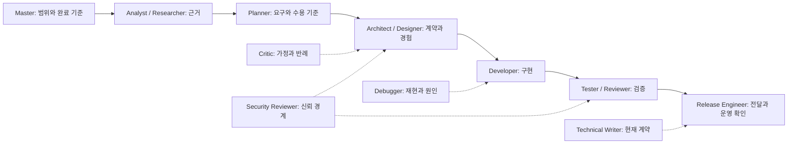

# Development Agents

개발 목표에 맞는 전문가를 선택하고, Claude Code·Codex·OpenCode에서 같은 역할 계약을 사용할 때 읽는 안내다. 각 역할은 책임·검토 관점·산출물과 완료 조건·금지 사항을 갖는다. 모델의 실제 역량을 보장하는 선언 대신 검증 가능한 행동을 정의한다.

## 역할 선택

| 역할 | 책임과 주요 산출물 | 변경 범위 |
|------|-------------------|-----------|
| [master](../claude/agents/master.md) | 범위·완료 기준, 작업 배정, 의사결정, 결과 통합 | 요청 전체를 조정하며 최종 검증 책임 |
| [analyst](../claude/agents/analyst.md) | 현재 구조·실행·데이터 흐름, 영향 범위와 근거 | 읽기 전용 |
| [researcher](../claude/agents/researcher.md) | 외부 기술·버전별 계약의 1차 자료와 비교 | 읽기 전용 |
| [planner](../claude/agents/planner.md) | 사용자 문제·우선순위·시나리오·수용 기준 | 읽기 전용, 기획안을 반환 |
| [architect](../claude/agents/architect.md) | 경계·인터페이스·데이터·실패·전환 설계 | 읽기 전용, 설계안을 반환 |
| [designer](../claude/agents/designer.md) | 사용자 흐름·상태·시각 체계·접근성·화면 검토 | 할당된 시안·프로토타입, 제품 코드는 명시 위임 시 |
| [developer](../claude/agents/developer.md) | 계약에 맞는 구현·회귀 검사 | 할당된 코드·테스트 |
| [tester](../claude/agents/tester.md) | 위험별 검증, 재현 가능한 결함 보고 | 할당된 테스트·fixture, 제품 수정은 인계 |
| [code-reviewer](../claude/agents/code-reviewer.md) | 특정 revision의 실제 결함·회귀 검토 | 읽기 전용, 공식 승인·PR 상태 변경 금지 |
| [security-reviewer](../claude/agents/security-reviewer.md) | 위협 모델·신뢰 경계·취약 경로 검토 | 읽기 전용, 운영 공격 금지 |
| [debugger](../claude/agents/debugger.md) | 실패 재현·가설 검증·원인 제거 | 진단은 읽기 전용, 수정 요청이면 할당 범위 수정 |
| [critic](../claude/agents/critic.md) | 주요 가정의 반례·실패 시나리오·대안 | 읽기 전용 |
| [release-engineer](../claude/agents/release-engineer.md) | 검증된 변경 전달·환경별 반영·정상 동작 확인 | 위임한 릴리즈·배포 범위와 Git Workflow 권한 |
| [technical-writer](../claude/agents/technical-writer.md) | 코드와 일치하고 실행 가능한 문서 | 할당된 문서·예제, 검토 요청은 읽기 전용 |

분석가는 현재 시스템의 사실을, 리서처는 외부 자료의 근거를 확인한다. 기획자는 무엇을 왜 만들지, 아키텍트는 어떤 계약으로 구현할지 정한다. 리뷰어는 코드의 결함을, 테스터는 실행 결과를, 반론자는 결정의 가정을 확인한다.

공통 협업 규칙은 [Agent Workflow](../claude/rules/agent-workflow.md), 반복 절차는 [Skills](SKILLS.md)에서 관리한다. commit·PR·문서 스킬을 역할마다 복제하지 않는다.

## 작업 흐름

메인 에이전트가 master의 책임을 수행한다. 간단한 작업은 직접 끝내고, 복잡한 작업은 불확실성과 위험에 맞춰 필요한 역할만 선택한다.



이 흐름은 필수 호출 순서가 아니다. 장애는 debugger부터, 작은 기능은 developer와 tester부터 시작할 수 있다. 문서·보안 검토는 마지막 단계까지 미루지 않는다. 각 산출물은 메인이 검증하고 통합한다.

위임에는 다음 정보를 전달한다. 해당하지 않는 항목은 생략한다.

```text
목표: 해결할 질문 또는 구현할 동작
맥락: 기준 commit/diff, 관련 경로, 확인된 사실
범위: 읽기 전용 또는 수정 허용 경로, 공유 인터페이스와 제약
산출물: 코드/분석/설계/테스트 결과와 근거 위치
완료 기준: 관찰할 결과와 실행할 검증
전달 권한: commit, PR, merge, 배포 중 맡긴 단계
```

동시 작업은 파일 소유권이 겹치지 않게 배정한다. 같은 인터페이스에 의존하면 먼저 계약을 확정한다. 결과에는 검증한 대상·환경·명령·결과와 남은 제약을 포함한다. 모델·동시 실행 한도는 세션 설정을 따르며 자동으로 변경하지 않는다.

## 도구별 사용

먼저 [AI Tools Sync](../README.md#배포와-결과-확인) 절차로 배포하고 새 세션을 연다. 아래 문장은 자연어 요청 예시다.

**Claude Code**: `/agents`에서 이름과 설명을 확인한다. `claude --agent master`로 master를 메인 역할로 선택할 수 있다. 일반 세션에서는 다음처럼 요청한다.

```text
analyst에게 현재 인증 흐름을 읽기 전용으로 조사하게 하고,
architect에게 호환성을 유지하는 변경안을 맡겨 주세요.
두 결과를 비교한 뒤 구현과 검증까지 진행해 주세요.
```

**Codex**: 공식 사용자 에이전트 형식은 `~/.codex/agents/*.toml`이다. 역할을 자연어로 지정한다. `$name`은 스킬 호출 문법이며 에이전트 호출 문법이 아니다. 클라이언트의 위임 도구가 역할 이름 선택을 지원하지 않으면 메인이 해당 TOML의 `developer_instructions`를 읽어 위임 메시지에 전달한다. 위임이 불가능하면 메인이 같은 지침을 적용한다.

```text
master 역할로 이 기능을 완성해 주세요.
planner에게 수용 기준을, architect에게 인터페이스 설계를 위임하고,
구현 후 tester와 code-reviewer가 결과를 검증하게 해 주세요.
```

**OpenCode V2**: `opencode debug agents`로 등록을 확인한다. master는 `mode: all`이라 메인 또는 하위 역할로 사용할 수 있고, 나머지는 `mode: subagent`다. 메인에게 필요한 역할의 위임을 요청한다.

이름이 보이지 않으면 파일 배포 여부, 도구 버전, 프로젝트별 같은 이름의 정의, 커스텀 설정 경로와 새 세션 여부를 확인한다. `CODEX_HOME`, `CLAUDE_CONFIG_DIR`, XDG 설정으로 기본 위치를 변경한 머신은 클라이언트가 실제로 읽는 경로를 따로 확인해야 한다. 이 저장소의 설치기는 README의 고정 대상에 배포한다. 클라이언트가 역할 또는 위임 기능을 제공하지 않으면 메인이 해당 관점으로 수행하고 그 제약을 보고한다.

## 원본·생성·권한

| 단계 | 파일과 계약 |
|------|-------------|
| 원본 | `claude/agents/*.md`: `name`, `description`, 선택적 `tools`, 역할 본문 |
| Codex 생성본 | `codex/agents/*.toml`: `name`, `description`, `developer_instructions` |
| OpenCode 생성본 | `opencode/agents/*.md`: `description`, `mode`, 선택적 `permissions`, 역할 본문 |
| 배포 | `~/.claude/agents/`, `~/.codex/agents/`, `~/.config/opencode/agents/` |

`scripts/gen-ai-tools.py`가 호출 문법·규칙 참조를 변환하고 삭제된 원본의 생성본도 정리한다. Codex의 스킬 UI 메타데이터인 `codex/skills/*/agents/openai.yaml`은 별개이며 직접 관리한다.

`tools`가 있으면 Claude는 도구 허용 목록으로 사용하고 OpenCode는 권한 목록으로 변환한다. 생략하면 클라이언트의 기본 도구·연결을 상속하며, 상위 권한·deny 규칙을 바꾸지 않는다. 구현·디자인·테스트·배포 역할은 연결된 브라우저·MCP·스킬을 사용할 수 있도록 도구 목록을 고정하지 않는다.

Codex 에이전트는 부모의 권한과 연결을 상속한다. Claude의 `tools`를 Codex의 샌드박스로 변환하지 않는다. **읽기 전용은 역할의 행동 계약이며, 별도 격리를 보장하지 않는다.** Claude·OpenCode에서 Bash·shell을 허용한 역할도 셸로 쓰기를 할 기술적 가능성이 있다. 강제 격리가 필요하면 부모 세션과 실행 환경의 권한을 설정한다. 역할 파일은 merge·배포 권한을 추가하지 않는다.

모델은 어느 도구에서도 고정하지 않는다. 각 머신의 계정·프로바이더·가용 모델과 부모 세션 선택을 유지한다. 도구별 모델을 선택해야 한다면 검증된 클라이언트 설정을 사용하고 공통 역할 원본에 다른 도구의 모델 ID를 넣지 않는다.

## 변경과 검증

```bash
python3 scripts/gen-ai-tools.py
python3 scripts/gen-ai-tools.py --check
python3 -m unittest discover -s tests -p 'test_ai_tools.py'
bash -n run.sh bin/dot
git diff --check
```

생성·동기화 검사는 TOML 변환, 도구별 참조, 잘못된 정의의 중단, 삭제된 생성본 정리, 임시 홈에서의 배포·반복 실행·백업·개인 파일 보존을 검증한다. 모델의 답변 품질까지 증명하지는 않는다. 실제 작업에서는 다음 시나리오로 역할과 인계 품질을 확인한다.

| 시나리오 | 관찰할 결과 |
|----------|-------------|
| 작은 버그 수정 | 불필요한 전체 팀 호출 없이 재현·최소 수정·회귀 검증 |
| 인증 기능 변경 | 요구·권한 경계·실패 계약이 구현과 테스트까지 연결됨 |
| 읽기 전용 분석 | 코드·설정·원격 상태 변경 없이 사실과 미확인을 구분함 |
| 의견이 갈리는 설계 | critic의 반례와 대안을 근거로 결정하고 반복 논쟁을 끝냄 |
| 일부 환경에 접근 불가 | 접근한 환경의 결과와 미검증 환경을 분리함 |
| 배포 실패 | 잘못된 완료 선언 없이 실패 근거·영향·복구 결과를 보고함 |

## 참고 자료

[Huddle 에이전트](https://huddle.ing/agents)의 [공개 역할 프리셋](https://huddle.ing/presets.js)은 리더·기획·리서치·분석·작성·디자인·개발·편집·리뷰·QA·보안·법무·반론·옹호의 14개 역할을 제공한다. 책임·검토 관점·완료 조건·금지 사항을 분리하는 구성을 참고했다. 여기서는 개발에 맞춰 아키텍처·디버깅·릴리즈 책임을 별도로 정의하고, 법무와 독립적인 옹호 역할은 기본 개발 팀에 넣지 않았다. 승인·Git 정책은 Huddle 예시가 아니라 이 저장소의 지침을 따른다.

클라이언트 형식과 로딩 규칙: [Claude Code subagents](https://code.claude.com/docs/en/sub-agents), [Codex subagents](https://learn.chatgpt.com/docs/agent-configuration/subagents), [OpenCode agents](https://opencode.ai/v2/docs/agents/).
