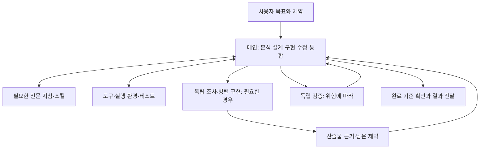

# Development Agents

메인 에이전트가 목표를 이해하고 분석·설계·구현·디버깅·검증을 이어가는 것이 기본이다. 14개 역할은 작업에 필요한 전문 기준을 제공한다. 역할이 등록되어 있다는 이유로 별도 에이전트를 실행하지 않는다.

이 문서는 Claude Code·Codex·OpenCode에서 역할을 선택하고, 독립 작업을 위임하고, 결과를 검증할 때 사용한다. 실행 규칙의 원본은 [Agent Workflow](../claude/rules/agent-workflow.md), 반복 절차는 [Skills](SKILLS.md)다. 역할의 이름이나 자신감 대신 실제 산출물과 근거로 품질을 판단한다.

## 작업 흐름

메인은 master의 책임과 필요한 전문 관점을 함께 수행한다. 같은 기능의 요구사항·코드·결정 이유가 계속 바뀌면 메인이 맥락을 유지한다. 필요한 역할 지침과 스킬만 읽고, 독립적인 읽기·검색·검사 도구를 먼저 병렬로 실행한다.



이 흐름은 역할별 호출 순서가 아니다. 작은 버그는 메인이 재현부터 회귀 검증까지 끝낼 수 있다. 큰 기능도 기획자·설계자·개발자를 차례로 호출할 필요는 없다. 문서·UX·보안·운영의 기준은 관련 결정을 내릴 때 적용한다.

### 언제 위임하는가

위임할 일은 **독립된 질문 또는 작업 범위와 검증 가능한 산출물**이 있어야 한다. 그 경계 안에서 다음 이점 중 하나가 조정·인계 비용보다 클 때 별도 실행한다.

| 분리의 이점 | 적합한 작업 | 먼저 확인할 조건 |
|-------------|-------------|------------------|
| 병렬 진행 | 서로 다른 모듈 구현, 독립 자료 조사 | 파일 소유권과 공유 인터페이스가 정해졌는가 |
| 독립 검증 | 변경분 리뷰, 사용자 흐름 검증, 중요한 설계의 반례 조사 | 원본 요구·코드·실행 근거로 판단할 수 있는가 |
| 컨텍스트 격리 | 방대한 로그·문서·코드 탐색 | 탐색 과정 대부분을 버리고 결론과 근거만 반환해도 되는가 |
| 실제 권한 분리 | 제한된 실행 환경에서 운영 검증 | 자격증명·도구·실행 환경에 강제 경계가 있는가 |

전문적인 판단이 필요하다는 이유만으로 분리하지 않는다. 이전 대화 전체가 필요하거나, 같은 파일을 바꾸거나, 결과를 받자마자 다시 상세 맥락을 물어야 한다면 메인이 이어가는 편이 낫다. 반복 질문·중복 조사·인터페이스 변경이 생기면 메인이 범위를 다시 나누거나 작업을 회수한다.

### 위임과 인계

메인은 실제 세션의 역할·도구·동시 실행 한도를 확인한다. 다음 정보를 작업 규모에 맞게 전달한다. 전체 대화를 상속했다고 가정하지 않으며, 시크릿이나 불필요한 로그를 전달하지 않는다.

```text
목표: 해결할 질문 또는 구현할 동작
맥락: 기준 commit/diff, 관련 경로, 확인된 사실과 필요한 제약
범위: 읽기 전용 또는 수정 허용 경로, 파일 소유권, 공유 인터페이스
산출물: 코드/분석/검증 결과와 원본 근거 위치
완료 기준: 관찰할 결과, 실행할 검사, 중단하거나 인계할 조건
전달 권한: commit, PR, merge, 배포 중 맡긴 단계
```

같은 파일의 작성자는 한 명으로 정한다. 공통 계약이 먼저 필요하면 확정한 뒤 병렬 구현을 시작한다. 다른 작업자의 변경은 보존한다. 전문가는 맡은 범위를 끝까지 수행하고 메인에 결과를 반환한다. 별도 지시 없이 다른 역할에 다시 위임하지 않는다.

인계에는 결과·변경 파일·정확한 검증 대상·환경·명령·결과·남은 제약을 담는다. 사실·가정·미확인을 구분하고, 요약만으로 확인할 수 없는 결론에는 원본 코드·diff·출처·실행 근거를 연결한다. 메인은 중요한 결론과 통합 결과를 직접 확인한다.

독립 리뷰에는 원본 요구사항, 정확한 revision 또는 명시한 작업 트리 diff, 재현 조건을 제공한다. 작성자의 결론을 정답으로 주지 않는다. 리뷰어는 근거를 직접 확인하며, 별도 에이전트의 동의만으로 정확성을 보장하지 않는다. 수정 후에는 영향을 받는 검사와 findings를 갱신하고, 반영하지 않은 지적에는 이유를 남긴다.

## 역할 선택

아래 표는 전문 관점과 해당 역할로 맡긴 작업의 허용 범위다. 메인이 관점만 참고할 때는 사용자 요청·프로젝트 지침이 정한 작업 범위를 유지한다. 해당 역할로 명시적으로 맡은 작업은 역할의 제한을 지킨다. 위임 조건이 성립하면 같은 역할 계약으로 별도 작업을 맡길 수 있다. 세부 사용 경계와 완료 조건은 각 역할 원본을 따른다.

| 역할 | 책임과 주요 산출물 | 변경 범위 |
|------|-------------------|-----------|
| [master](../claude/agents/master.md) | 목표·완료 기준, 직접 문제 해결, 필요한 위임과 결과 통합 | 요청 전체와 최종 검증 책임 |
| [analyst](../claude/agents/analyst.md) | 현재 구조·실행·데이터 흐름, 영향 범위와 재현 가능한 근거 | 읽기 전용 |
| [researcher](../claude/agents/researcher.md) | 외부 기술·버전별 계약의 1차 자료와 비교 | 읽기 전용 |
| [planner](../claude/agents/planner.md) | 사용자 문제·우선순위·시나리오·검증 가능한 수용 기준 | 읽기 전용, 기획·수용 검토 결과 반환 |
| [architect](../claude/agents/architect.md) | 대안 비교, 경계·인터페이스·데이터·실패·전환 계약 | 읽기 전용, 설계·검토 결과 반환 |
| [designer](../claude/agents/designer.md) | 사용자 흐름·상태·시각 체계·접근성·실제 화면 검토 | 할당된 시안·프로토타입, 제품 코드는 명시 위임 시 |
| [developer](../claude/agents/developer.md) | 계약에 맞는 구현·회귀 검사 | 할당된 코드·테스트 |
| [tester](../claude/agents/tester.md) | 실제 동작과 수용 기준 검증, 재현 가능한 결함 보고 | 할당된 테스트·fixture, 제품 수정은 메인에 인계 |
| [code-reviewer](../claude/agents/code-reviewer.md) | 특정 revision의 실제 결함·회귀 검토 | 읽기 전용, 공식 승인·PR 상태 변경 금지 |
| [security-reviewer](../claude/agents/security-reviewer.md) | 위협 모델·신뢰 경계·취약 경로 검토 | 읽기 전용, 운영 공격 금지 |
| [debugger](../claude/agents/debugger.md) | 실패 재현·가설 검증·원인 제거 | 진단은 읽기 전용, 수정 요청이면 할당 범위 수정 |
| [critic](../claude/agents/critic.md) | 중요한 가정의 반례·실패 조건·대안·판별 실험 | 읽기 전용 |
| [release-engineer](../claude/agents/release-engineer.md) | 검증된 변경 전달·환경별 반영·정상 동작 확인 | 위임한 릴리즈·배포 범위와 Git Workflow 권한 |
| [technical-writer](../claude/agents/technical-writer.md) | 코드와 일치하고 실행 가능한 문서·독립 편집 검토 | 할당된 문서·예제, 검토 요청은 읽기 전용 |

분석가는 현재 시스템의 사실을, 리서처는 외부 계약의 근거를 확인한다. 리뷰어는 코드의 결함을, 테스터는 실행 결과를, 반론자는 결정의 가정을 확인한다. 역할마다 commit·PR·문서 절차를 복제하지 않고 필요한 스킬을 사용한다.

## 도구별 사용

먼저 [AI Tools Sync](../README.md#배포와-결과-확인) 절차로 배포하고 새 세션을 연다.

| 도구 | 역할 확인과 사용 |
|------|------------------|
| Claude Code | `/agents`에서 이름과 설명을 확인한다. `claude --agent master`로 메인 역할을 선택하거나 일반 세션에서 목표를 요청한다. |
| Codex | `~/.codex/agents/*.toml`의 역할을 자연어로 지정한다. `$name`은 스킬 호출 문법이며 에이전트 호출 문법이 아니다. |
| OpenCode V2 | `opencode debug agents`로 등록을 확인한다. master는 `mode: all`, 나머지는 `mode: subagent`다. 필요한 독립 작업을 메인에게 위임하도록 요청한다. |

기본 요청은 역할의 호출 순서보다 목표와 완료 기준을 전달한다.

```text
인증 만료 후 재로그인이 실패하는 버그를 재현하고 수정해 주세요.
기존 인증 계약을 보존하고, 실패했던 경로와 관련 회귀를 검증해 주세요.
분석부터 수정까지 메인이 이어가고, 독립 검증이 필요하면 범위를 정해 맡겨 주세요.
```

독립된 질문이 있으면 범위를 지정해 위임할 수 있다.

```text
메인은 인증 수정과 회귀 검증을 진행해 주세요.
researcher에게는 사용 중인 인증 라이브러리 버전의 갱신 토큰 계약만
공식 자료로 확인하게 하고, 출처와 적용 조건을 반환받아 주세요.
수정이 끝나면 code-reviewer에게 해당 diff와 원본 수용 기준으로
권한 우회와 기존 세션의 회귀를 읽기 전용으로 검토하게 해 주세요.
```

이름이 보이지 않으면 파일 배포 여부, 도구 버전, 프로젝트별 같은 이름의 정의, 커스텀 설정 경로와 새 세션 여부를 확인한다. `CODEX_HOME`, `CLAUDE_CONFIG_DIR`, XDG 설정으로 기본 위치를 변경한 머신은 클라이언트가 실제로 읽는 경로를 따로 확인해야 한다. 이 저장소의 설치기는 README의 고정 대상에 배포한다.

역할 이름을 선택할 수 없는 위임 도구라면 메인이 배포된 역할 본문을 읽고 작업 지시와 함께 전달한다. Codex에서는 TOML의 `developer_instructions`를 사용한다. 위임 자체가 불가능하면 메인이 해당 관점으로 수행하고 독립 검증을 실행하지 못한 범위를 밝힌다. 파일이 없으면 이름만으로 전문 지침이 로드되었다고 가정하지 않는다.

## 원본·생성·권한

| 단계 | 파일과 계약 |
|------|-------------|
| 원본 | `claude/agents/*.md`: `name`, `description`, 선택적 `tools`, 역할 본문 |
| Codex 생성본 | `codex/agents/*.toml`: `name`, `description`, `developer_instructions` |
| OpenCode 생성본 | `opencode/agents/*.md`: `description`, `mode`, 선택적 `permissions`, 역할 본문 |
| 배포 | `~/.claude/agents/`, `~/.codex/agents/`, `~/.config/opencode/agents/` |

`scripts/gen-ai-tools.py`가 호출 문법·규칙 참조를 변환하고 삭제된 원본의 생성본도 정리한다. Codex의 스킬 UI 메타데이터인 `codex/skills/*/agents/openai.yaml`은 별개이며 직접 관리한다.

`tools`가 있으면 Claude는 도구 허용 목록으로 사용하고 OpenCode는 권한 목록으로 변환한다. 생략하면 클라이언트의 기본 도구·연결을 상속하며, 상위 권한·deny 규칙을 바꾸지 않는다. 구현·디자인·테스트·배포 역할은 연결된 브라우저·MCP·스킬을 사용할 수 있도록 도구 목록을 고정하지 않는다.

Codex 에이전트는 부모의 권한과 연결을 상속한다. Claude의 `tools`를 Codex의 샌드박스로 변환하지 않는다. **읽기 전용은 역할의 행동 계약이며, 별도 격리를 보장하지 않는다.** Claude·OpenCode에서 Bash·shell을 허용한 역할도 셸로 쓰기를 할 기술적 가능성이 있다. 강제 격리가 필요하면 실행 환경·자격증명·도구 권한에 경계를 설정한다. 역할 파일은 merge·배포 권한을 추가하지 않는다.

모델은 어느 도구에서도 고정하지 않는다. 각 머신의 계정·프로바이더·가용 모델과 부모 세션 선택을 유지한다. 도구별 모델을 선택해야 한다면 검증된 클라이언트 설정을 사용하고 공통 역할 원본에 다른 도구의 모델 ID를 넣지 않는다. 동시 실행 한도도 세션 설정을 따른다.

## 변경과 검증

### 생성·동기화 검사

저장소 루트에서 원본을 수정한 뒤 실행한다.

```bash
python3 scripts/gen-ai-tools.py
python3 scripts/gen-ai-tools.py --check
python3 -m unittest discover -s tests -p 'test_ai_tools.py'
bash -n run.sh bin/dot
git diff --check
```

생성·동기화 검사는 TOML 변환, 도구별 참조, 잘못된 정의의 중단, 삭제된 생성본 정리, 임시 홈에서의 배포·반복 실행·백업·개인 파일 보존을 검증한다. 실패하면 원본과 변환 계약을 수정하고 다시 검사한다. 생성본을 직접 고쳐 통과시키지 않는다. 이 검사는 모델의 작업 수행 품질을 증명하지 않는다.

### 실제 작업 품질 비교

위임 정책을 바꿀 때는 이전 지침과 변경 지침을 같은 작업으로 비교한다. 아래는 평가 절차이며, 이 문서 자체가 실행 결과를 뜻하지 않는다.

1. 대표 작업 10~20개로 시작한다. 각 사례에 시작 commit·작업 트리·입력·환경, 허용된 변경, 관찰 가능한 성공 조건과 금지 동작을 고정한다. 운영 변경은 격리된 환경과 테스트 데이터로 재현한다.
2. 모델·도구·권한·시간과 비용 한도 등 조건을 맞춘다. 매 실행 전 작업 상태를 복원하고, 이전 실행의 답이나 메모리가 다음 실행에 들어가지 않도록 분리한다. 접근할 수 없는 외부 시스템은 대체 범위와 한계를 기록한다.
3. 두 지침으로 각 사례를 여러 번 실행한다. 우연한 성공 한 번이나 전체 평균만으로 선택하지 않는다. 통과에서 실패로 바뀐 사례와 비용이 큰 실패를 개별 확인한다.
4. 아래 결과를 기록한다. 역할 호출 수 자체에 가점을 주지 않고, 최종 상태와 실제 사용자 동작을 평가한다. 근거 없는 완료 보고도 실패로 센다.
5. 요구 누락·회귀·권한 위반이 생기면 원인을 고친다. 차이가 작거나 실행별 변동이 크면 사례와 반복 횟수를 늘린다. 품질을 유지하면서 완료 시간·비용을 줄이거나, 같은 예산으로 더 나은 결과를 내는 변경을 채택한다.

| 기록할 항목 | 판정 근거 |
|-------------|-----------|
| 작업 완료와 정확성 | 수용 기준별 충족·미충족·미확인, 실제 최종 상태·회귀 검사 |
| 독립 검증의 가치 | 재현된 실제 결함, 잘못된 지적, 수정 후 재검증 |
| 인계 비용 | 중복 조사, 누락된 조건, 재설명, 통합 충돌 |
| 효율 | 전체 완료 시간, 사용 토큰·비용, 성공한 작업당 총비용 |
| 권한 준수 | 허용되지 않은 쓰기·배포·데이터 변경 여부 |

| 대표 시나리오 | 관찰할 결과 |
|---------------|-------------|
| 작은 버그 수정 | 메인이 재현·최소 수정·회귀 검증을 연결함 |
| 여러 플랫폼의 설정 변경 | 공통 계약과 플랫폼 차이를 보존하고 통합 결과를 확인함 |
| 인증 기능 변경 | 요구·권한 경계·실패 계약이 구현과 테스트까지 연결됨 |
| 방대한 독립 자료 조사 | 탐색을 나누어도 원본 근거와 적용 조건이 최종 판단에 남음 |
| 읽기 전용 분석 | 코드·설정·원격 상태 변경 없이 사실과 미확인을 구분함 |
| 의견이 갈리는 설계 | 반례와 판별 실험으로 결정하고 근거 없는 논쟁을 끝냄 |
| 일부 환경에 접근 불가 | 접근한 환경의 결과와 미검증 환경을 분리함 |
| 배포 실패 | 잘못된 완료 선언 없이 영향·복구·미완료 범위를 보고함 |

## 참고 자료

- [Anthropic: When to fold subagents into your main agent loop](https://claude.com/ko/resources/articles/building-agents-when-to-fold-subagents-into-your-main-agent-loop): 공유 맥락을 유지하는 실행과 독립 작업의 경계를 검토할 때 참고한다.
- [Huddle 역할 프리셋](https://huddle.ing/presets.js): 책임·검토 관점·완료 조건·금지 사항을 구분하는 역할 구성을 참고했다. 이 저장소의 권한은 자체 Git·보안 지침을 따른다.
- 클라이언트 형식과 로딩 규칙: [Claude Code subagents](https://code.claude.com/docs/en/sub-agents), [Codex subagents](https://learn.chatgpt.com/docs/agent-configuration/subagents), [OpenCode agents](https://opencode.ai/v2/docs/agents/).
